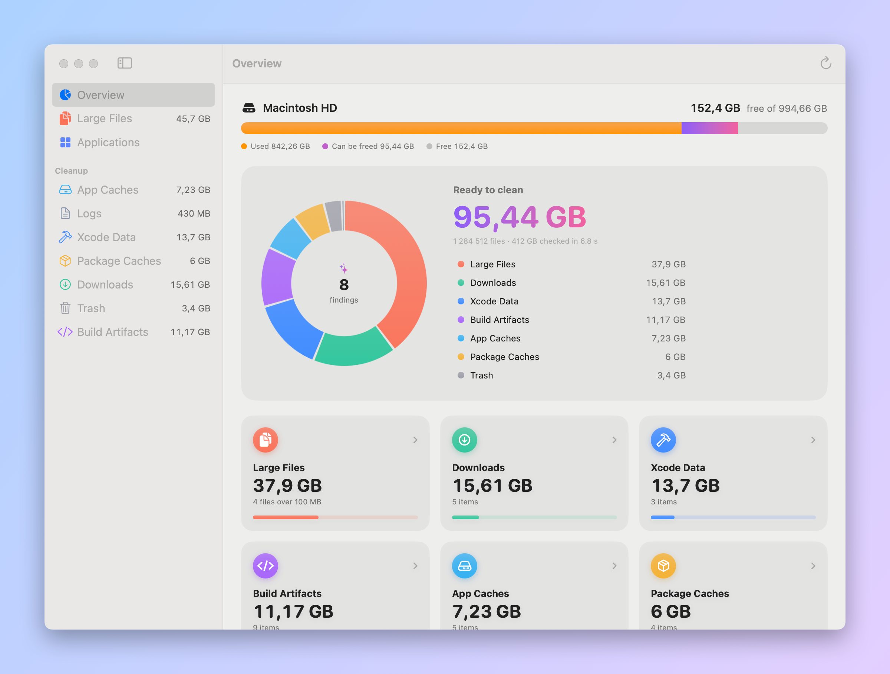
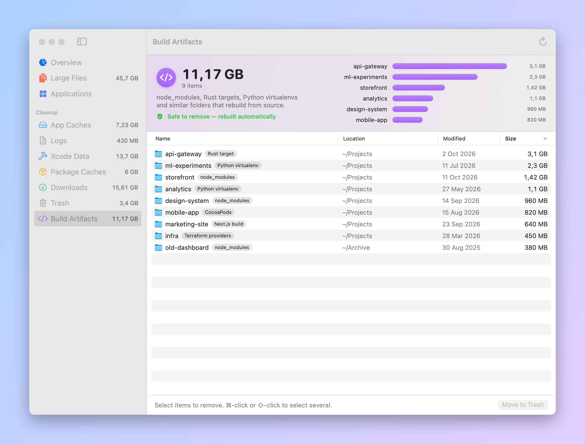

# MacWand

[](https://github.com/ypankovych/macwand/releases/latest)
[](https://github.com/ypankovych/macwand/actions/workflows/ci.yml)
[](LICENSE)


MacWand is a fast, native disk cleaner for macOS. Try the live demo at **[macwand.dev](https://macwand.dev)**.
It finds what's taking up space (large files, caches, old downloads, build folders and apps you no
longer use) and helps you clear it safely.

The scanner is written in Rust and checks a couple of million files in seconds. The app is
SwiftUI, so it looks and behaves like part of macOS. Nothing is removed until you confirm, and
everything goes to the Trash first.

MacWand works on **macOS 12 Monterey and later**, on both Apple silicon and Intel Macs.

<picture>
  <source media="(prefers-color-scheme: dark)" srcset="docs/screenshots/overview-dark.png">
  
</picture>

* [Features](#features)
* [Install](#install)
* [Usage](#usage)
* [What it looks for](#what-it-looks-for)
* [Safety and privacy](#safety-and-privacy)
* [FAQ](#faq)
* [Building from source](#building-from-source)
* [Contributing](#contributing)
* [License](#license)

## Features

* **Fast**: a parallel Rust scanner walks your home folder and streams results while it works,
  so findings appear within seconds.
* **Everything in one place**: large files, app caches, logs, Xcode data, package-manager caches,
  Downloads, the Trash, project build folders and unused apps.
* **Developer-aware**: finds `node_modules`, Rust `target`, Python virtualenvs, CocoaPods,
  `.next` and Terraform folders, listed by the project they belong to.
* **Real uninstalls**: removing an app also removes the support files it keeps in `~/Library`
  (containers, caches, preferences, saved state and so on).
* **Honest sizes**: counts the space files actually use on disk, so sparse files and iCloud
  files that aren't downloaded don't inflate the numbers, and hard links are counted once.
* **Safe by default**: every removal is confirmed and goes to the Trash.
* **Native**: SwiftUI with light and dark mode, sortable tables and keyboard shortcuts.
* **Free and open source** under the MIT license. No accounts, no network access, no telemetry.

## Install

1. Download **MacWand-x.y.z.dmg** from the [latest release](https://github.com/ypankovych/macwand/releases/latest).
2. Open it and drag **MacWand** into **Applications**.
3. Open MacWand from Applications and click **Scan My Mac**.

MacWand isn't notarized by Apple yet, so Gatekeeper blocks the first launch.
To allow it:

* **macOS 15 Sequoia and later**: try to open the app once, then go to
  *System Settings › Privacy & Security* and click **Open Anyway** next to the MacWand message.
* **macOS 14 and earlier**: right-click (or <kbd>⌃</kbd>-click) MacWand in Applications, choose
  **Open**, then confirm.
* Or, from Terminal: `xattr -dr com.apple.quarantine /Applications/MacWand.app`

You can check the download against the `.sha256` file published with each release.

For a complete scan, give MacWand **Full Disk Access** (the app shows a button for it). Without it,
macOS hides Mail, Safari and other apps' data, and asks once each about Desktop, Documents and
Downloads.

## Usage

1. Click **Scan My Mac** (or press <kbd>⌘</kbd> + <kbd>R</kbd>). Results appear as they're found.
2. The **Overview** shows how much you could free and where it is. Hover a slice or a legend row
   to see its size; click it to open that section.
3. In a section, select what you want to remove and click **Move to Trash**.

<picture>
  <source media="(prefers-color-scheme: dark)" srcset="docs/screenshots/build-artifacts-dark.png">
  
</picture>

| Action | Keys |
| --- | --- |
| Start a scan | <kbd>⌘</kbd> + <kbd>R</kbd> |
| Stop the scan | <kbd>⌘</kbd> + <kbd>.</kbd> |
| Select several items | <kbd>⌘</kbd>-click, <kbd>⇧</kbd>-click, <kbd>⌘</kbd> + <kbd>A</kbd> |
| Remove the selection | <kbd>⌘</kbd> + <kbd>⌫</kbd> |
| Show an item in Finder | double-click, or right-click › **Reveal in Finder** |

Click a column header to sort by name, location, date or size. In **Applications**, turn on
*Only apps not used in 3 months* to see uninstall candidates.

Space moved to the Trash is freed when you empty the Trash. Items in the **Trash** section are
already there, so removing them deletes them permanently.

## What it looks for

| Section | Where | |
| --- | --- | --- |
| Large Files | anywhere in your home folder | Files of 100 MB or more. Review before removing. |
| Applications | `/Applications`, `~/Applications` | Each app's size, its support files in `~/Library` and when it was last used. |
| App Caches | `~/Library/Caches` | Rebuilt by apps as needed. |
| Logs | `~/Library/Logs` | |
| Xcode Data | DerivedData, device support, simulator caches | Rebuilt by Xcode. |
| Xcode Archives | `~/Library/Developer/Xcode/Archives` | Keep the ones you need for crash reports. |
| Simulator Devices | `~/Library/Developer/CoreSimulator/Devices` | |
| Package Caches | npm, pnpm, Cargo, Gradle, Maven, Go, `~/.cache` | Downloaded again when needed. |
| iPhone & iPad Backups | `~/Library/Application Support/MobileSync/Backup` | Review before removing. |
| Mail Attachments | Mail's downloads folder | Copies of attachments you opened. |
| Downloads | `~/Downloads` | Review before removing. |
| Trash | `~/.Trash` | Removing these deletes them permanently. |
| Build Artifacts | your projects | `node_modules`, Rust `target`, virtualenvs, `Pods`, `.next`, `.terraform`. Rebuilt from source. |

Each section is labeled either *safe to remove* (rebuilt automatically) or *review before removing*.

## Safety and privacy

* **Nothing is removed without confirmation**, and removed items go to the Trash, where you can
  put them back. Only items that are already in the Trash are deleted permanently.
* **The scanner can't delete.** It only reads file names, sizes and dates; all removal happens in
  the app, through the Trash.
* **Your documents are never opened.** The only files MacWand reads are apps' `Info.plist`, for
  their names. Photos libraries are skipped entirely.
* **Running apps are never uninstalled.** Quit an app first.
* **Offline.** MacWand makes no network connections and collects nothing.

Found a vulnerability? See [SECURITY.md](SECURITY.md).

## FAQ

### Why does the scan slow down near the end?

That's `~/Library/Containers`, where sandboxed apps keep their data. macOS checks access for every
folder in there, one folder at a time across the whole system, at about 10 ms each, even with
Full Disk Access. Nothing an app can do avoids it. Everything else is done in a few seconds, and
results stay usable while the containers finish.

### How does it know when I last used an app?

It takes the later of Spotlight's last-used date and the last time the app's executable was
read, which happens whenever the app is launched. Spotlight data is often missing, so this is an
approximation; check the date before uninstalling.

### Why isn't my Photos library listed?

Looking inside a Photos library triggers a privacy prompt, and Photos manages that storage itself.
Use *Photos › Settings › iCloud › Optimize Mac Storage* to shrink it.

### Moving an app to the Trash asks for my password

Apps installed from the App Store, or by an installer, belong to the system. MacWand then asks
Finder to move them, and Finder asks for your password, the same as dragging them to the Trash
yourself.

### Is anything ever sent anywhere?

No. MacWand has no networking code and no analytics.

## Building from source

You need the Xcode Command Line Tools (`xcode-select --install`) and Rust
([rustup](https://rustup.rs)). Full Xcode is optional.

```sh
git clone https://github.com/ypankovych/macwand.git
cd macwand
rustup target add aarch64-apple-darwin x86_64-apple-darwin
cargo test --manifest-path engine/Cargo.toml   # scanner tests
scripts/build.sh          # build/MacWand.app: universal, macOS 12+, ad-hoc signed
scripts/package.sh        # build/MacWand-<version>.dmg and .zip, with SHA-256 checksums
scripts/screenshots.sh    # regenerates docs/screenshots from the real UI with demo data
```

Run the scanner on its own, which prints JSON lines:

```sh
cargo run --release --manifest-path engine/Cargo.toml -- scan | head
cargo run --release --manifest-path engine/Cargo.toml -- sizes ~/Library/Caches
```

<details>
<summary>Why the scripts call <code>swiftc</code> instead of <code>swift build</code></summary>

SwiftPM in some Command Line Tools installs fails with `unable to lookup item 'PlatformPath'`.
Calling `swiftc` directly avoids that and makes the universal, back-deployed build simple: each
architecture is compiled for macOS 12 and the slices are joined with `lipo`. Newer SwiftUI APIs are
used only behind `#available` checks, so any unguarded use fails the build.
</details>

### Project layout

| | |
| --- | --- |
| `engine` | Rust scanner: parallel walk, cleanup categories, build-artifact detection. Streams JSON lines; never deletes. |
| `app/Sources/MacWand/Engine` | Runs the scanner and decodes its events |
| `app/Sources/MacWand/Model` | Scan results and the actions on them (`ScanStore`) |
| `app/Sources/MacWand/Services` | App bundle inspection, the Trash, disk capacity |
| `app/Sources/MacWand/Views` | SwiftUI views |
| `scripts` | Build, package, icon and screenshot scripts |
| `website` | The [macwand.dev](https://macwand.dev) site with the in-browser demo; `website/deploy.sh` publishes it |

## Contributing

Bug reports, ideas and pull requests are welcome. Please read [CONTRIBUTING.md](CONTRIBUTING.md)
first.

## License

[MIT](LICENSE) © Yaroslav Pankovych
